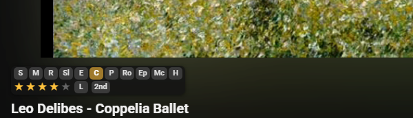

# YouTube Channel Playlist Collector

<p>
  <a href="https://proj-yeet.github.io/yt-music-library/"></a>
  <a href="https://github.com/ProJ-Yeet/yt-channel-playlist-collector/raw/main/channel-full-playlist.user.js"></a>
  <a href="https://ko-fi.com/projyeet"></a>
</p>
<p>
  <a href="https://www.youtube.com/@proj-yeet"></a>
  <a href="https://discord.gg/htkpNjk5yq"></a>
</p>

A Tampermonkey userscript for people who keep their music in YouTube playlists. It pulls a
whole channel (and its "- Topic" channel) into a playlist, without the songs you already
have. It also rates songs and files them into the right playlist, removes duplicates and
dead videos, and watches your bookmarked channels for new uploads.

It works with the **[Music Library website](https://proj-yeet.github.io/yt-music-library/)**
([source](https://github.com/ProJ-Yeet/yt-music-library)). Ratings you set on YouTube show up
there instantly, where anyone you share it with can filter and play them.

### Why support it

It's free and will stay free. One person writes it in spare time, against a real library of
17,000 songs. If it has saved you an evening of sorting playlists by hand, a coffee on
[Ko-fi](https://ko-fi.com/projyeet) helps. Never required, always appreciated. Ideas and bug
reports are just as welcome on [Discord](https://discord.gg/htkpNjk5yq).

## Install

1. Install [Tampermonkey](https://www.tampermonkey.net/).
2. Open [`channel-full-playlist.user.js`](channel-full-playlist.user.js) → **Raw**, and
   Tampermonkey offers to install it.
3. Optional companions:
   - [`ytml-bridge.user.js`](ytml-bridge.user.js) for the Music Library. After installing it,
     open the website and sign in with Google once.
   - [`bookmarks-bridge.user.js`](bookmarks-bridge.user.js) and
     [`bookmarks-mover-extension/`](bookmarks-mover-extension) (load unpacked) for the
     bookmark features.

Everything runs through YouTube's own internal API while you're logged in, so there are no API
keys or quotas.

## What it does

**Rating strip.** Every video gets a small strip. The category letters are on top (S Song,
M Music, R Relax, Sl Slow, E Electric, C Classical, P Pop, Ro Rock, Ep Epic, Mc Minecraft,
H Hololive, which takes any VTuber), and the stars, **L** (Long) and **2nd** (Secondary) are below. One click files the
song:




- It goes into the playlist for that combination, such as "4★ Song" or "3★ Relax · Long", and
  leaves the playlist you're in.
- Each combination's playlist is made when its first song arrives. When it reaches YouTube's
  5,000 cap the next one starts ("Songs 3" → "Songs 4").
- Anything over 15 minutes is always Long.
- Ratings changed on the website get carried out the next time YouTube is open.

**Collecting**

| Button | |
|---|---|
| ⊕ Collect All | a channel's uploads + its Topic channel's releases into a playlist, minus what's already in your chosen playlists, Shorts, live streams and title+length duplicates |
| ⊞ Collect multiple channels | the same for a list of channels at once |
| ⧉ Copy playlist | one playlist into another |
| 🆕 New songs | new uploads from the channels in a bookmarks folder |
| 📥 Pull batch | the full back catalogue of the next N bookmarked channels, then moves their bookmarks to "done" |

**Cleaning up**

| Button | |
|---|---|
| 🧹 Dedupe | duplicates across playlists, exact or fuzzy (same song, different upload), with side-by-side compare |
| ⊘ Unavailable | removes deleted / private / region-blocked videos and saves their links |
| ✂ Remove Shorts, 🚫 Remove a channel | what they say |
| ☑ Select & move | tick rows on a playlist page and move, copy or remove them together |
| 📜 History | every removal and move, filterable, with undo |

**Also:** ✓ marks on thumbnails of songs you already have, "New to you" picked on the home
feed automatically, and bookmark tools (📌 bookmark a playlist's channels, 🔖 find duplicate
bookmarks, 🔤 sort folders).

## Music Library setup

🗂 Library shows how many songs are in the library and how many are waiting to move. It also
imports your existing playlists: you map each one to a rating, and where a song is in several
playlists the highest rating wins. It recognises VTuber songs (Hololive or any other) by channel and name, and you can untick
any channel before saving. 🧹 Tidy then removes the duplicate copies. Each removal is logged in
📜 History, so it can be undone.

The bridge is a separate script because the collector runs inside YouTube's page with
`@grant none`. A script there can't keep a login for another site, so the small sandboxed
bridge holds the website sign-in and talks to the database.

## Development

```
node --test tests/library.test.cjs tests/quick-actions.test.cjs tests/paging.test.cjs
```

Changes by version are in [CHANGELOG.md](CHANGELOG.md).

## Credits

- The way the buttons are added to YouTube's chip bar copies the "YouTube Play All" userscript.
- Built with help from Claude (Anthropic).

Licensed under [MIT](LICENSE).
